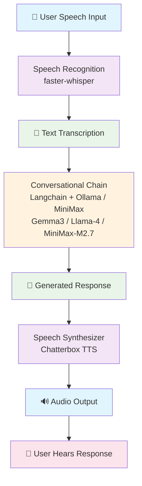

## Build your own voice assistant and run it locally: Whisper + Ollama + Piper

> Original article: https://blog.duy-huynh.com/build-your-own-voice-assistant-and-run-it-locally/
>
> **Updated for this project (Step 4 of the project plan)**: now using [Piper](https://github.com/OHF-Voice/piper1-gpl), a fast, fully local, open-source neural TTS engine, instead of Chatterbox — Chatterbox speaks German with a noticeable English accent, and this project doesn't need its voice-cloning or emotion controls. See `backend/tts.py` for details.
>
> The original implementation using Bark has been preserved in the `archive-2025-05-29` branch for reference.

[](https://www.buymeacoffee.com/vndee)


After my latest post about how to build your own RAG and run it locally. Today, we're taking it a step further by not only implementing the conversational abilities of large language models but also adding listening and speaking capabilities. The idea is straightforward: we are going to create a voice assistant reminiscent of Jarvis or Friday from the iconic Iron Man movies, which can operate offline on your computer.

**TTS: Piper**
- 🇩🇪 **Natural German voices**: purpose-built voices, not an accented multilingual model
- 🚀 **Fast**: real-time synthesis, even on a plain CPU
- 🧩 **Simple**: one fixed voice per model — no cloning, no emotion controls, which this project doesn't need (see the project plan, Step 4)

### Techstack
First, you should set up a virtual Python environment. You have several options for this, including pyenv, virtualenv, poetry, and others that serve a similar purpose. Personally, I'll use Poetry for this tutorial due to my personal preferences. Here are several crucial libraries you'll need to install:

- **rich**: For a visually appealing console output.
- **faster-whisper**: A fast reimplementation of OpenAI's Whisper for speech-to-text conversion (same models and accuracy, runs significantly faster — see the project plan, Step 5).
- **piper-tts**: Fast, local, natural-sounding text-to-speech (German voices).
- **langchain**: A straightforward library for interfacing with Large Language Models (LLMs).
- **langchain-openai**: For connecting to OpenAI-compatible cloud LLM providers like [MiniMax](https://www.minimaxi.com).
- **sounddevice**, **pyaudio**, and **speechrecognition**: Essential for audio recording and playback.

For a detailed list of dependencies, refer to the link here.

The most critical component here is the Large Language Model (LLM) backend. By default, we use **Ollama** for running LLMs locally. Alternatively, you can use **MiniMax** as a cloud LLM provider for higher-quality responses without local GPU requirements. If Ollama is new to you, I recommend checking out my previous article on offline RAG: "Build Your Own RAG and Run It Locally: Langchain + Ollama + Streamlit". Basically, you just need to download the Ollama application, pull your preferred model, and run it.

### Architecture
Okay, if everything has been set up, let's proceed to the next step. Below is the overall architecture of our application, which fundamentally comprises 3 main components:

- **Speech Recognition**: Utilizing faster-whisper (a faster reimplementation of OpenAI's Whisper), we convert spoken language into text. Whisper's training on diverse datasets ensures its proficiency across various languages and dialects.
- **Conversational Chain**: For the conversational capabilities, we'll employ the Langchain interface with a pluggable LLM backend — either a local model via Ollama (e.g., Gemma3, Llama-4) or a cloud model via [MiniMax](https://www.minimaxi.com) (MiniMax-M2.7). This setup promises a seamless and engaging conversational flow.
- **Speech Synthesizer**: The transformation of text to speech is achieved through Piper, a fast, fully local neural TTS engine with natural-sounding, purpose-built German voices.

The workflow is straightforward: record speech, transcribe to text, generate a response using an LLM, and vocalize the response using Piper.



### Installation

**⚠️ Important**: We strongly recommend using [uv](https://docs.astral.sh/uv/) for dependency management instead of pip with `requirements.txt`. The `requirements.txt` file was generated by `uv pip freeze` and contains pinned versions that may not install correctly across different systems.

#### Option 1: Using uv (Recommended)

```bash
# Install uv if you haven't already
curl -LsSf https://astral.sh/uv/install.sh | sh
# or on macOS: brew install uv
# or on Windows: powershell -ExecutionPolicy ByPass -c "irm https://astral.sh/uv/install.ps1 | iex"

# Clone the repository
git clone https://github.com/vndee/local-talking-llm.git
cd local-talking-llm

# Install dependencies using uv (recommended)
uv sync

# Activate the virtual environment
source .venv/bin/activate  # On Windows: .venv\Scripts\activate
```

#### Option 2: Using pip (Alternative)

If you prefer to use pip, install directly from pyproject.toml:

```bash
# Clone the repository
git clone https://github.com/vndee/local-talking-llm.git
cd local-talking-llm

# Create virtual environment
python -m venv venv
source venv/bin/activate  # On Windows: venv\Scripts\activate

# Install from pyproject.toml (NOT requirements.txt)
pip install -e .
```

#### Install and Setup Ollama

```bash
# Install and start Ollama
# Follow instructions at https://ollama.ai
ollama pull gemma3  # or any other model you prefer
```

#### Setup MiniMax (Cloud LLM Alternative)

If you don't have a local GPU or prefer higher-quality cloud models, you can use [MiniMax](https://www.minimaxi.com) as the LLM backend:

1. Sign up at [MiniMax Platform](https://www.minimaxi.com) and get your API key
2. Set the environment variable:
   ```bash
   export MINIMAX_API_KEY="your-api-key-here"
   ```

No Ollama installation is needed when using MiniMax — the LLM runs in the cloud while TTS and STT still run locally.

### Usage

#### One-time setup: download a Piper voice
Before running the voice condition for the first time, download the German voice (only needs to be done once per machine):
```bash
python -m piper.download_voices de_DE-thorsten-high --download-dir tts_models
```
Other German voices you can use instead (see `study_content/study_settings.yaml`'s `tts_voice` setting to switch): `de_DE-thorsten-medium`, `de_DE-kerstin-low`, `de_DE-eva_k-x_low`. Run `python -m piper.download_voices` with no arguments to list every available voice, in any language.

#### Basic Usage
```bash
python backend/app.py
```

#### With Custom Settings
```bash
# Use a different LLM model
python backend/app.py --model codellama

# Save generated voice samples to voices/
python backend/app.py --save-voice
```

#### With MiniMax Cloud LLM
```bash
# Use MiniMax as the LLM provider (requires MINIMAX_API_KEY env var)
python backend/app.py --provider minimax

# Use a specific MiniMax model with custom temperature
python backend/app.py --provider minimax --model MiniMax-M2.7 --temperature 0.8

# Pass API key directly
python backend/app.py --provider minimax --api-key your-api-key-here
```

### Configuration Options

- `--provider`: LLM provider (`ollama` or `minimax`, default: ollama)
- `--api-key`: API key for cloud LLM providers (or use `MINIMAX_API_KEY` env var)
- `--temperature`: LLM temperature (0.0-1.0, default: 0.7)
- `--model`: Ollama model to use (default: gemma3)
- `--language`: Language code for speech transcription (default: from `study_settings.yaml`)
- `--save-voice`: Save generated audio responses to `voices/` directory
- `--web`: Run as a local web server instead of terminal mode

The TTS voice itself (which Piper voice to speak with) is not a command-line
option — it's set via `tts_voice` in `study_content/study_settings.yaml`,
since it's a researcher setting, not a technical one.

### Implementation Details

#### TextToSpeechService with Piper
`backend/tts.py` wraps Piper — a single fixed voice model, no cloning, no
per-line emotion controls:

```python
from piper import PiperVoice

class TextToSpeechService:
    def __init__(self, voice_name: str = "de_DE-thorsten-high"):
        model_path = f"tts_models/{voice_name}.onnx"
        config_path = f"tts_models/{voice_name}.onnx.json"
        self.voice = PiperVoice.load(model_path, config_path=config_path)

    def synthesize(self, text: str):
        chunks = list(self.voice.synthesize(text))  # one chunk per sentence
        sample_rate = chunks[0].sample_rate
        audio = np.concatenate([c.audio_float_array for c in chunks])
        return sample_rate, audio
```

Why this is a good fit for a research interview: a fixed, natural-sounding
voice speaks every participant's session identically — no variability from
voice cloning or emotion heuristics to account for when analyzing results.

### Tips for Best Results

1. **Voice choice**: `de_DE-thorsten-high` is the best-quality German voice
   currently available in Piper. Female German voices (`kerstin`, `eva_k`)
   exist but only at lower quality tiers as of this writing — worth
   listening to both before committing to one for real data collection.
2. **Performance**: Piper runs in real time even on a CPU; no GPU is
   required. Consider using smaller Whisper models ("tiny" or "base") if
   transcription feels slow on your machine.

### Scaling to Production

For those aiming to elevate this application to a production-ready status, consider:

- **Performance Optimization**:
  - Use optimized inference engines (ONNX, TensorRT)
  - Implement model quantization for faster inference
  - Add caching for frequently used phrases

- **Enhanced Features**:
  - Multi-speaker support with voice profiles
  - Real-time voice conversion
  - Integration with more LLM providers
  - Web interface with real-time streaming

- **Voice Database**:
  - Create a library of voice samples
  - Implement voice selection UI
  - Add voice mixing capabilities

- **API Service**:
  - RESTful API for TTS requests
  - WebSocket support for real-time communication
  - Rate limiting and authentication

### Troubleshooting

#### Dependency Installation Issues

**Problem**: `requirements.txt` installation fails with errors like:
- `ERROR: Could not find a version that satisfies the requirement cPython==0.0.6`
- `ModuleNotFoundError: No module named 'distutils'`
- Various version conflicts

**Solution**: The `requirements.txt` file was generated by `uv pip freeze` and contains exact versions that may not work across different systems. Use one of these alternatives:

1. **Use uv (Recommended)**:
   ```bash
   uv sync
   ```

2. **Use pip with pyproject.toml**:
   ```bash
   pip install -e .
   ```

3. **Manual installation of core packages**:
   ```bash
   pip install piper-tts langchain-ollama faster-whisper sounddevice rich
   ```

#### Runtime Issues

- **CUDA out of memory**: Use CPU mode or reduce model precision
- **Microphone not working**: Check system permissions and device settings
- **Slow inference**: Ensure you're using GPU if available, consider using smaller Whisper models
- **Piper voice not found**: Make sure you ran `python -m piper.download_voices <voice-name> --download-dir tts_models` first (see the Usage section above)
- **Import errors**: Make sure you activated the virtual environment before running the app

### Conclusion

With Whisper for listening, Ollama (or MiniMax) for the conversational core, and Piper for natural German speech, this is a fully-featured voice assistant that runs entirely offline. No cloud services, no API keys, just local AI — now shaped into a modular research platform (see the project plan for the full roadmap).

### Resources

- [Piper GitHub](https://github.com/OHF-Voice/piper1-gpl)
- [Piper voice samples](https://rhasspy.github.io/piper-samples/)
- [Ollama](https://ollama.ai)
- [MiniMax Platform](https://www.minimaxi.com)
- [faster-whisper](https://github.com/SYSTRAN/faster-whisper)
- [Original Blog Post](https://blog.duy-huynh.com/build-your-own-voice-assistant-and-run-it-locally/)

---

