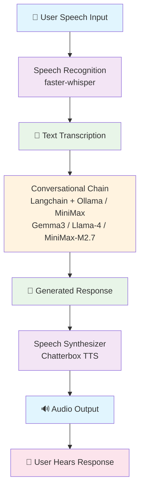

## SCID-based multi-agent interview (MAGI-inspired) — research prototype

> **Not a diagnostic tool.** The system supports structured interviewing for
> research. It does not make or suggest psychiatric diagnoses, computes no
> totals or thresholds, and does not replace a clinician. Tests in this repo are
> software-behaviour checks, not clinical validation.

### Architecture (minimal; built on the existing app)
Every typed (or transcribed) participant message goes through
`backend/app.py → process_answer() → agents/interview_orchestrator.handle_turn()`:

| Step | Component | Role |
|---|---|---|
| 0 | `safety_check.py` (unchanged) | keyword check on every message, runs before and independently of the interview logic |
| 1 | Orchestrator | deterministic check for explicit skip commands (`skip_phrases`) — works even if the model is down |
| 2 | **Judgment Agent** `agents/judgment_agent.py` (LLM) | classifies the latest message against the current item: `intent` (answer / clarification_request / cannot_answer / refusal / off_topic / unclear) and, separately, `sufficiency` (sufficient / ambiguous / insufficient = "enough to assess", not "symptom present"); for items with a rating scheme also a **provisional** ?/0/1/2 rating + verbatim evidence quote. JSON output is schema-validated and post-checked in code |
| 3 | **Navigation Agent** `agents/navigation_agent.py` (rules) | *proposes* advance / clarify / rephrase / skip (decision table in the file) |
| 4 | Orchestrator | *validates* the proposal (clarification budget, existing transition target) and *executes* it on `interview_guide.py` state |
| 5 | **Question Agent** `agents/question_agent.py` (LLM) | only for clarify/rephrase: one explanation/clarification of the SAME item (meaning, criterion, timeframe kept); output validated, deterministic fallback |
| 6 | `session_record.py` | researcher-only JSON per interview in `session_records/` (git-ignored) |

The short acknowledgement after a sufficient answer still comes from the
behavior-profile prompt (`study_content/prompts/`), but is now generated only
after the decision, so it cannot contradict what happens next.
No Diagnosis Agent, no RAG, no additional agents.

### Interaction rules — source-defined vs. project-specific
* **Source-defined (SCID-5-PD):** coding ? = inadequate information, 0 = absent,
  1 = subthreshold, 2 = threshold; per-criterion rating anchors; follow-up probes.
  Per-disorder thresholds exist in the source but are **not executed**.
* **Project-specific (ours, not SCID rules):** clarification budget
  `default_max_clarifications: 1` per item (configurable per item); a refusal or
  "skip" skips immediately; an item still unresolved after the budget is skipped
  and recorded as `unresolved` (rating "?"); off-topic/unclear replies get one
  neutral redirect within the same budget; "I don't understand" gets one
  explanation + reformulation; "I don't know" gets one gentle follow-up.
  **A skipped item is never a negative answer.**
* **Model failures** (connection error, malformed JSON after one retry) are
  logged as `system_events`, the participant is asked to resend, nothing is
  advanced or recorded as a result, and after 3 consecutive failures the
  interview pauses ("please contact the study team").

### Interview content
* `study_content/interviews/scid5pd_de.yaml` (**active**): SKID-5-PD — open
  overview questions, then all 10 personality disorders in SCID order and Other
  Specified PD (148 items, 135 asked; all 106 numbered SCID questions). Use is
  covered by the project's APA permission. **The German wording is an unofficial
  working translation of the English SCID-5-PD — to be reviewed by the project
  psychologist before use with participants.** Criteria and rating anchors stay
  in English (agents only). The demographic General Overview is left out.
  * Not asked by the chatbot (recorded as "clinician rating required"):
    "observed during interview" items, Criterion B exclusion items that depend on
    clinical evidence, the age criterion, Other Specified PD; Schizoid A5 refers
    to Schizotypal A8 (Q44); Schizotypal A5 is derived from Paranoid A1–A4/A7.
  * Source routing executed: Antisocial PD Criterion C gate (≥2 Conduct Disorder
    criteria rated "2" → adult criteria A; else → Other Specified PD), evaluated
    on the **provisional** chatbot ratings; "IF CAN'T ANSWER, MOVE ON" for the
    first overview question. Diagnostic thresholds are not executed.
* `study_content/interviews/depression_scid_example.yaml`: 3 team-written
  development questions (NOT SCID), used by the automated flow tests.
* Switch the active guide with `interview_guide:` in `study_content/study_settings.yaml`.

### Setup (Windows, text mode)
```powershell
cd local-talking-llm-main
uv venv .venv
# uv.lock pins numpy 1.26, which needs Python 3.11/3.12 for "uv sync".
# With Python 3.13 install the current compatible versions instead:
uv pip install --python .venv\Scripts\python.exe "faster-whisper>=1.0.0" "flask>=3.1.3" "langchain-ollama>=0.3.3" "langchain-openai>=0.3.0" "langchain>=0.3.25" "numpy>=1.26.0" "piper-tts>=1.6.0" "pyyaml>=6.0.2" "rich>=14.0.0" "scipy>=1.15.3" "setuptools>=80.9.0" "sounddevice>=0.5.2" pytest
```
Model (needed for real interviews — all participant text stays on this PC):
install [Ollama](https://ollama.com), then `ollama pull gemma3` and keep Ollama
running. (Alternative: `--provider minimax` with `MINIMAX_API_KEY` — sends
participant text to a cloud service; not for real study data.)

### Running on another PC
Copy the `local-talking-llm-main` folder **without** `.venv` and
`session_records`, then on the new PC: install Python ≥ 3.11 and
[uv](https://docs.astral.sh/uv/), run the setup commands above, install Ollama
and `ollama pull gemma3`, and launch as below. Session records are stored only
on the PC where the interview took place.

### Launch
```powershell
.venv\Scripts\python.exe backend\app.py --web            # http://127.0.0.1:5000
.venv\Scripts\python.exe backend\app.py --web --port 5050 # if port 5000 is taken
```
Open the URL in a browser and use the text condition. Without a running model
the app starts, but every answer returns the "technical problem" message
(only explicit skip commands work). Voice models (Whisper/Piper) are now
loaded only when a voice feature is used.

### Tests
```powershell
.venv\Scripts\python.exe -m pytest -q
```
`tests/test_agents.py` (decision table, validation rules, guide state) and
`tests/test_interview_flow.py` (complete flows through the Flask endpoints with
a scripted model: positive, negative, short, ambiguous, explanation request,
cannot answer, refusal/skip, off-topic, narrow example, budget exhaustion,
safety keyword, malformed/failed model, provisional ratings).

### Known limitations / open decisions
* Not yet tested with a real model (Ollama); prompt quality must be checked on
  real model output before any study use (Ollama temperature is not yet set).
* German SCID wording is an unofficial translation pending psychologist review.
* The Antisocial PD gate relies on provisional chatbot ratings; a wrong
  provisional rating can route past (or into) the adult criteria — the
  session record lists the counted criteria for the clinician to verify.
* The SCID asks about suicidal behaviour (Borderline criterion 5). The source
  requires a clinician to assess any current suicidal thoughts; the chatbot
  only shows the existing safety hint and flags these items in the record.
* Keyword safety check is unchanged and blunt (see `backend/safety_check.py`).
* Single participant at a time (global state), as in the original design.

### Next steps for development (handover, 25 Oct 2026)
1. Install Ollama + a model and run real interviews in text mode; review the
   Judgment/Question Agent outputs in the console trace (`[agents] trace=...`) and
   the JSON in `session_records/`. All tests so far use a scripted fake model.
2. Wire the `--temperature` option into the Ollama client (currently only MiniMax
   uses it); a low temperature is advisable for the Judgment Agent.
3. Have the project psychologist review the German wording in
   `study_content/interviews/scid5pd_de.yaml` (unofficial translation).
4. Decide with the supervisor/psychologist: clinician availability for the
   suicidality items (Borderline criterion 5), and whether the Antisocial PD gate
   may rely on provisional chatbot ratings.
5. Before/after evidence of the fixes (old code vs. new code, same scripted
   answers): refusal was asked twice more → now skipped immediately; "skip" was
   ignored → now honoured even when the model is down; "I don't understand"
   looped forever → one reformulation, then move on; unresolved answers advanced
   silently → recorded as "skipped/unresolved", never as "no".

---

## Build your own voice assistant and run it locally: Whisper + Ollama + Piper

> Original article: https://blog.duy-huynh.com/build-your-own-voice-assistant-and-run-it-locally/
>
> **Updated for this project (Step 4 of the project plan)**: now using [Piper](https://github.com/OHF-Voice/piper1-gpl), a fast, fully local, open-source neural TTS engine, instead of Chatterbox — Chatterbox speaks German with a noticeable English accent, and this project doesn't need its voice-cloning or emotion controls. See `backend/tts.py` for details.
>
> The original implementation using Bark has been preserved in the `archive-2025-05-29` branch for reference.

[](https://www.buymeacoffee.com/vndee)


After my latest post about how to build your own RAG and run it locally. Today, we're taking it a step further by not only implementing the conversational abilities of large language models but also adding listening and speaking capabilities. The idea is straightforward: we are going to create a voice assistant reminiscent of Jarvis or Friday from the iconic Iron Man movies, which can operate offline on your computer.

**TTS: Piper**
- 🇩🇪 **Natural German voices**: purpose-built voices, not an accented multilingual model
- 🚀 **Fast**: real-time synthesis, even on a plain CPU
- 🧩 **Simple**: one fixed voice per model — no cloning, no emotion controls, which this project doesn't need (see the project plan, Step 4)

### Techstack
First, you should set up a virtual Python environment. You have several options for this, including pyenv, virtualenv, poetry, and others that serve a similar purpose. Personally, I'll use Poetry for this tutorial due to my personal preferences. Here are several crucial libraries you'll need to install:

- **rich**: For a visually appealing console output.
- **faster-whisper**: A fast reimplementation of OpenAI's Whisper for speech-to-text conversion (same models and accuracy, runs significantly faster — see the project plan, Step 5).
- **piper-tts**: Fast, local, natural-sounding text-to-speech (German voices).
- **langchain**: A straightforward library for interfacing with Large Language Models (LLMs).
- **langchain-openai**: For connecting to OpenAI-compatible cloud LLM providers like [MiniMax](https://www.minimaxi.com).
- **sounddevice**, **pyaudio**, and **speechrecognition**: Essential for audio recording and playback.

For a detailed list of dependencies, refer to the link here.

The most critical component here is the Large Language Model (LLM) backend. By default, we use **Ollama** for running LLMs locally. Alternatively, you can use **MiniMax** as a cloud LLM provider for higher-quality responses without local GPU requirements. If Ollama is new to you, I recommend checking out my previous article on offline RAG: "Build Your Own RAG and Run It Locally: Langchain + Ollama + Streamlit". Basically, you just need to download the Ollama application, pull your preferred model, and run it.

### Architecture
Okay, if everything has been set up, let's proceed to the next step. Below is the overall architecture of our application, which fundamentally comprises 3 main components:

- **Speech Recognition**: Utilizing faster-whisper (a faster reimplementation of OpenAI's Whisper), we convert spoken language into text. Whisper's training on diverse datasets ensures its proficiency across various languages and dialects.
- **Conversational Chain**: For the conversational capabilities, we'll employ the Langchain interface with a pluggable LLM backend — either a local model via Ollama (e.g., Gemma3, Llama-4) or a cloud model via [MiniMax](https://www.minimaxi.com) (MiniMax-M2.7). This setup promises a seamless and engaging conversational flow.
- **Speech Synthesizer**: The transformation of text to speech is achieved through Piper, a fast, fully local neural TTS engine with natural-sounding, purpose-built German voices.

The workflow is straightforward: record speech, transcribe to text, generate a response using an LLM, and vocalize the response using Piper.



### Installation

**⚠️ Important**: We strongly recommend using [uv](https://docs.astral.sh/uv/) for dependency management instead of pip with `requirements.txt`. The `requirements.txt` file was generated by `uv pip freeze` and contains pinned versions that may not install correctly across different systems.

#### Option 1: Using uv (Recommended)

```bash
# Install uv if you haven't already
curl -LsSf https://astral.sh/uv/install.sh | sh
# or on macOS: brew install uv
# or on Windows: powershell -ExecutionPolicy ByPass -c "irm https://astral.sh/uv/install.ps1 | iex"

# Clone the repository
git clone https://github.com/vndee/local-talking-llm.git
cd local-talking-llm

# Install dependencies using uv (recommended)
uv sync

# Activate the virtual environment
source .venv/bin/activate  # On Windows: .venv\Scripts\activate
```

#### Option 2: Using pip (Alternative)

If you prefer to use pip, install directly from pyproject.toml:

```bash
# Clone the repository
git clone https://github.com/vndee/local-talking-llm.git
cd local-talking-llm

# Create virtual environment
python -m venv venv
source venv/bin/activate  # On Windows: venv\Scripts\activate

# Install from pyproject.toml (NOT requirements.txt)
pip install -e .
```

#### Install and Setup Ollama

```bash
# Install and start Ollama
# Follow instructions at https://ollama.ai
ollama pull gemma3  # or any other model you prefer
```

#### Setup MiniMax (Cloud LLM Alternative)

If you don't have a local GPU or prefer higher-quality cloud models, you can use [MiniMax](https://www.minimaxi.com) as the LLM backend:

1. Sign up at [MiniMax Platform](https://www.minimaxi.com) and get your API key
2. Set the environment variable:
   ```bash
   export MINIMAX_API_KEY="your-api-key-here"
   ```

No Ollama installation is needed when using MiniMax — the LLM runs in the cloud while TTS and STT still run locally.

### Usage

#### One-time setup: download a Piper voice
Before running the voice condition for the first time, download the German voice (only needs to be done once per machine):
```bash
python -m piper.download_voices de_DE-thorsten-high --download-dir tts_models
```
Other German voices you can use instead (see `study_content/study_settings.yaml`'s `tts_voice` setting to switch): `de_DE-thorsten-medium`, `de_DE-kerstin-low`, `de_DE-eva_k-x_low`. Run `python -m piper.download_voices` with no arguments to list every available voice, in any language.

#### Basic Usage
```bash
python backend/app.py
```

#### With Custom Settings
```bash
# Use a different LLM model
python backend/app.py --model codellama

# Save generated voice samples to voices/
python backend/app.py --save-voice
```

#### With MiniMax Cloud LLM
```bash
# Use MiniMax as the LLM provider (requires MINIMAX_API_KEY env var)
python backend/app.py --provider minimax

# Use a specific MiniMax model with custom temperature
python backend/app.py --provider minimax --model MiniMax-M2.7 --temperature 0.8

# Pass API key directly
python backend/app.py --provider minimax --api-key your-api-key-here
```

### Configuration Options

- `--provider`: LLM provider (`ollama` or `minimax`, default: ollama)
- `--api-key`: API key for cloud LLM providers (or use `MINIMAX_API_KEY` env var)
- `--temperature`: LLM temperature (0.0-1.0, default: 0.7)
- `--model`: Ollama model to use (default: gemma3)
- `--language`: Language code for speech transcription (default: from `study_settings.yaml`)
- `--save-voice`: Save generated audio responses to `voices/` directory
- `--web`: Run as a local web server instead of terminal mode

The TTS voice itself (which Piper voice to speak with) is not a command-line
option — it's set via `tts_voice` in `study_content/study_settings.yaml`,
since it's a researcher setting, not a technical one.

### Implementation Details

#### TextToSpeechService with Piper
`backend/tts.py` wraps Piper — a single fixed voice model, no cloning, no
per-line emotion controls:

```python
from piper import PiperVoice

class TextToSpeechService:
    def __init__(self, voice_name: str = "de_DE-thorsten-high"):
        model_path = f"tts_models/{voice_name}.onnx"
        config_path = f"tts_models/{voice_name}.onnx.json"
        self.voice = PiperVoice.load(model_path, config_path=config_path)

    def synthesize(self, text: str):
        chunks = list(self.voice.synthesize(text))  # one chunk per sentence
        sample_rate = chunks[0].sample_rate
        audio = np.concatenate([c.audio_float_array for c in chunks])
        return sample_rate, audio
```

Why this is a good fit for a research interview: a fixed, natural-sounding
voice speaks every participant's session identically — no variability from
voice cloning or emotion heuristics to account for when analyzing results.

### Tips for Best Results

1. **Voice choice**: `de_DE-thorsten-high` is the best-quality German voice
   currently available in Piper. Female German voices (`kerstin`, `eva_k`)
   exist but only at lower quality tiers as of this writing — worth
   listening to both before committing to one for real data collection.
2. **Performance**: Piper runs in real time even on a CPU; no GPU is
   required. Consider using smaller Whisper models ("tiny" or "base") if
   transcription feels slow on your machine.

### Scaling to Production

For those aiming to elevate this application to a production-ready status, consider:

- **Performance Optimization**:
  - Use optimized inference engines (ONNX, TensorRT)
  - Implement model quantization for faster inference
  - Add caching for frequently used phrases

- **Enhanced Features**:
  - Multi-speaker support with voice profiles
  - Real-time voice conversion
  - Integration with more LLM providers
  - Web interface with real-time streaming

- **Voice Database**:
  - Create a library of voice samples
  - Implement voice selection UI
  - Add voice mixing capabilities

- **API Service**:
  - RESTful API for TTS requests
  - WebSocket support for real-time communication
  - Rate limiting and authentication

### Troubleshooting

#### Dependency Installation Issues

**Problem**: `requirements.txt` installation fails with errors like:
- `ERROR: Could not find a version that satisfies the requirement cPython==0.0.6`
- `ModuleNotFoundError: No module named 'distutils'`
- Various version conflicts

**Solution**: The `requirements.txt` file was generated by `uv pip freeze` and contains exact versions that may not work across different systems. Use one of these alternatives:

1. **Use uv (Recommended)**:
   ```bash
   uv sync
   ```

2. **Use pip with pyproject.toml**:
   ```bash
   pip install -e .
   ```

3. **Manual installation of core packages**:
   ```bash
   pip install piper-tts langchain-ollama faster-whisper sounddevice rich
   ```

#### Runtime Issues

- **CUDA out of memory**: Use CPU mode or reduce model precision
- **Microphone not working**: Check system permissions and device settings
- **Slow inference**: Ensure you're using GPU if available, consider using smaller Whisper models
- **Piper voice not found**: Make sure you ran `python -m piper.download_voices <voice-name> --download-dir tts_models` first (see the Usage section above)
- **Import errors**: Make sure you activated the virtual environment before running the app

### Conclusion

With Whisper for listening, Ollama (or MiniMax) for the conversational core, and Piper for natural German speech, this is a fully-featured voice assistant that runs entirely offline. No cloud services, no API keys, just local AI — now shaped into a modular research platform (see the project plan for the full roadmap).

### Resources

- [Piper GitHub](https://github.com/OHF-Voice/piper1-gpl)
- [Piper voice samples](https://rhasspy.github.io/piper-samples/)
- [Ollama](https://ollama.ai)
- [MiniMax Platform](https://www.minimaxi.com)
- [faster-whisper](https://github.com/SYSTRAN/faster-whisper)
- [Original Blog Post](https://blog.duy-huynh.com/build-your-own-voice-assistant-and-run-it-locally/)

---
# V4 Database Architecture

<!-- EMSAG: 03.11.2026 — Document the initial PostgreSQL infrastructure and its architectural decisions. -->

## Overview

As part of the V4 architecture development, PostgreSQL was introduced as the primary relational database for persistent interview data storage.

The previous V3 implementation used a local JSON-based `SessionRecorder`. While this approach provided basic interview recording functionality, it offered limited capabilities for structured querying, relational data management, and longitudinal interview analysis.

The new database infrastructure establishes the foundation for storing participant records, interview sessions, SCID item outcomes, original participant responses, AI-generated assessments, navigation decisions, and technical system events.

The implementation uses:

- **PostgreSQL 18.4** – Relational database management system.
- **SQLAlchemy 2.x** – Object-Relational Mapping (ORM).
- **Alembic** – Database schema migrations.
- **Psycopg 3** – PostgreSQL database driver.
- **python-dotenv** – Environment configuration.

## 1. Database Configuration

A dedicated PostgreSQL database named `local_talking_llm` was created.

| Setting | Configuration |
|---|---|
| Database | `local_talking_llm` |
| Host | `localhost` |
| Port | `5432` |
| Encoding | UTF-8 |
| Database user | `emirs` |

Database credentials are loaded from the project-root `.env` file using the `DATABASE_URL` environment variable.

The `.env` file is excluded from Git through `.gitignore`. An `.env.example` file provides the configuration template without exposing actual credentials.

**Why?**

Centralized configuration avoids hardcoded credentials, supports environment-specific settings, and reduces the risk of accidentally committing sensitive connection information.

## 2. SQLAlchemy Infrastructure

The database infrastructure is organized under `backend/database/`.

```text
backend/database/
├── __init__.py
├── base.py
├── connection.py
├── models/
│   ├── __init__.py
│   ├── participant.py
│   ├── interview_session.py
│   ├── interview_item_record.py
│   ├── participant_turn.py
│   ├── judgment_assessment.py
│   ├── navigation_decision.py
│   └── system_event.py
└── migrations/
    ├── env.py
    ├── versions/
    └── README
```

### Database connection

`connection.py` initializes the SQLAlchemy engine and `SessionLocal`.

It also provides a `test_connection()` function to verify database connectivity.

The engine uses `pool_pre_ping=True` to detect stale connections before reuse.

### Declarative base

`base.py` defines the shared SQLAlchemy `Base` class and a consistent naming convention for database constraints and indexes.

All database models inherit from this base.

**Why?**

A shared metadata structure allows SQLAlchemy and Alembic to discover all models and manage schema changes consistently.

## 3. Database Schema

The initial schema consists of seven relational tables.

| Table | Purpose |
|---|---|
| `participants` | Stores pseudonymized participant records. |
| `interview_sessions` | Stores individual interview sessions and their lifecycle. |
| `interview_item_records` | Stores SCID item outcomes and provisional ratings. |
| `participant_turns` | Preserves original participant responses and conversational turns. |
| `judgment_assessments` | Stores structured AI-generated Judgment Agent assessments. |
| `navigation_decisions` | Records recommended and executed SCID navigation decisions. |
| `system_events` | Stores technical events and system failures. |

### 3.1 Participants

The `participants` table stores pseudonymized participant identifiers.

Each participant has a unique pseudonym and can be associated with multiple interview sessions.

**Design rationale:** Participant identity and interview history are separated to support longitudinal data management and data minimization.

### 3.2 Interview Sessions

The `interview_sessions` table represents individual interview sessions.

It references the participant and stores the interview guide identifier, guide version, session status, and timestamps.

**Design rationale:** Preserving the guide version makes historical interviews interpretable even when SCID content changes over time.

### 3.3 Interview Item Records

The `interview_item_records` table stores the final processing state of each SCID item.

The supported statuses are:

- `answered`
- `skipped`
- `not_asked`
- `derived`
- `gate`

**Design rationale:** A skipped item represents missing information, not a negative answer. Provisional ratings are retained for clinician review and must not be treated as final clinical diagnoses.

### 3.4 Participant Turns

The `participant_turns` table stores individual conversational turns, including the question and the original participant response.

**Design rationale:** Original responses must remain separate from AI-generated interpretations. This preserves the evidence used during assessment and supports later review.

### 3.5 Judgment Assessments

The `judgment_assessments` table stores structured Judgment Agent outputs, including:

- Response intent
- Response sufficiency
- Provisional rating
- Missing information
- Evidence quotes
- Reasoning
- Validation notes

**Design rationale:** AI-generated assessments are stored separately from participant responses and clinician-confirmed conclusions.

### 3.6 Navigation Decisions

The `navigation_decisions` table records SCID navigation recommendations and the transitions actually executed.

It distinguishes between:

- `recommended_next_item_id`
- `executed_next_item_id`

**Design rationale:** The Diagnosis Agent can recommend the next SCID item based on SCID criteria and source-defined branching logic. The Interview Orchestrator validates the recommendation, while the InterviewGuide remains responsible for actual navigation.

This separation preserves the existing architecture and prevents an AI recommendation from directly controlling interview state.

### 3.7 System Events

The `system_events` table stores technical events such as LLM failures, database errors, and unexpected execution problems.

**Design rationale:** Technical failures must not be confused with participant responses or assessment evidence.

## 4. Relationships and Data Integrity

The initial schema establishes the following relationships:

- One participant can have multiple interview sessions.
- One interview session can contain multiple SCID item records.
- One interview session can contain multiple participant turns.
- One interview session can contain multiple Judgment Assessments.
- One interview session can contain multiple navigation decisions.
- One interview session can contain multiple system events.

Foreign key constraints enforce relational integrity.

The initial schema also defines appropriate deletion behavior:

- `RESTRICT` for participant deletion when interview sessions still reference the participant.
- `CASCADE` for session-dependent records.
- `SET NULL` for selected optional references.

## 5. Alembic Migrations

Alembic was initialized under:

`backend/database/migrations/`

The configuration loads the database URL from `.env` and uses `Base.metadata` as its migration target.

The initial migration was generated with:

```powershell
.\.venv\Scripts\python.exe -m alembic revision --autogenerate -m "create initial database schema"
```

Generated migration:

`942f417a7d13_create_initial_database_schema.py`

The migration was reviewed and successfully applied.

```powershell
.\.venv\Scripts\python.exe -m alembic upgrade head
```

The database revision was verified using:

```powershell
.\.venv\Scripts\python.exe -m alembic current
```

Verified revision:

```text
942f417a7d13 (head)
```

**Result:** All seven initial tables were successfully created in PostgreSQL.

## 6. Architectural Principles

The database design follows these principles:

1. **Separation of concerns:** Participant records, original responses, AI assessments, navigation decisions, and technical events are stored independently.
2. **Longitudinal support:** Multiple interview sessions can be associated with one pseudonymized participant.
3. **Traceability:** AI assessments and navigation decisions can be related to their corresponding interview data.
4. **SCID integrity:** Navigation must follow the actual SCID branching and evaluation rules.
5. **Clinical responsibility:** AI-generated provisional ratings do not replace qualified clinician interpretation.
6. **Data minimization:** Pseudonymization and separation of identifying information reduce unnecessary exposure.
7. **Migration management:** Alembic provides version-controlled database schema evolution.

## 7. Implementation Status

| Component | Status |
|---|---|
| PostgreSQL installation and configuration | Completed |
| SQLAlchemy connection infrastructure | Completed |
| Environment configuration | Completed |
| Seven database models | Completed |
| Model registration and validation | Completed |
| Alembic configuration | Completed |
| Initial migration generation | Completed |
| Initial migration execution | Completed |
| PostgreSQL revision verification | Completed |
| PostgreSQL-backed SessionRecorder | Pending |
| Historical interview data retrieval | Pending |
| Diagnosis Agent integration | Pending |
| Orchestrator persistence integration | Pending |
| Clinician-facing DOCX report generation | Pending |

## 8. Next Development Phase

The next phase focuses on integrating the existing `SessionRecorder` with PostgreSQL.

The transition will preserve the existing V3 interview workflow and the responsibility of the `InterviewGuide` for interview state and navigation.

Subsequent development will address:

1. PostgreSQL-backed session persistence.
2. Historical interview data retrieval.
3. Diagnosis Agent integration with SCID criteria and source-defined branching logic.
4. Orchestrator validation and persistence.
5. Clinician-facing DOCX report generation.

**Current limitation:** The PostgreSQL infrastructure and initial schema are implemented, but the running chatbot has not yet been integrated with PostgreSQL persistence. The existing JSON-based recording mechanism remains in place until the SessionRecorder integration is implemented and tested.

